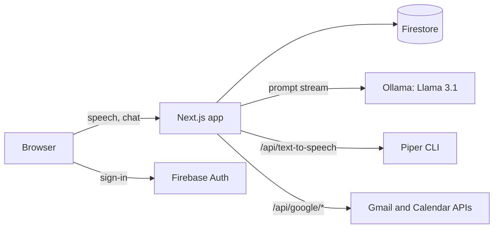

<div align="center">

# YourAI

A voice-first AI health assistant. Talk to it, ask about your Gmail inbox, and book doctor appointments on Google Calendar, all powered by a local Llama 3.1 model and Piper text-to-speech.


</div>

## Overview

YourAI started as a hackathon project. The aim is to make personal health tools usable by voice. The repository holds three related pieces:

1. **Voice health assistant ("Asha")**, in the repo root. This Next.js 14 app is the main project. You sign in with Google, say the wake word, and talk to a locally hosted Llama 3.1 model. Replies stream into a chat view and are read aloud through Piper. Requests about email or appointments are routed to the Gmail and Google Calendar APIs.
2. **Health dashboard**, in `client/` and `server/`. This is an earlier React + Express + MongoDB app. It shows simulated wearable data and an OpenAI-generated motivational summary, and it lets users upload hospital reports.
3. **Voice tooling**, in `VoiceModelTraining/` and `wishper/`. These Python scripts build a dataset for training a custom Piper voice, and a small Flask service offers Whisper transcription.

## Features

### Voice assistant (Next.js)

- **Google sign-in**: Firebase Auth with a Google provider that requests the Gmail read-only and Calendar scopes. User records are saved to Firestore.
- **Wake word and speech input**: the Web Speech API listens for "hey asha" (or "hello"), then captures the user's question.
- **Local LLM chat**: prompts, including the last 5 messages of context, go to Llama 3.1 through Ollama (`http://localhost:11434`) using LangChain, and the reply streams back token by token.
- **Expressive speech output**: each finished sentence is tagged with an emotion and sent to `/api/text-to-speech`. That route runs the Piper CLI and returns a WAV file. Sentences are queued so playback stays in order.
- **Gmail queries**: "unread", "important", "sent" and "draft" requests fetch matching messages through `/api/google/gmail`. The model then summarizes them.
- **Appointment booking**: appointment requests create a one-hour "Doctor Appointment" event through `/api/google/calendar`.
- **Multiple chats**: a sidebar for creating and switching between conversations.
- **Profile and questionnaire**: `/profile` and `/questionnaire` pages save the user's profile and a health questionnaire (blood group, diabetes, blood pressure, and so on) to Firestore.

### Health dashboard (client + server)

- **JWT auth**: register and log in with bcrypt-hashed passwords stored in MongoDB.
- **Simulated wearable data**: each request to `/get/getdata` generates and stores random heart-rate, blood-pressure, SpO2, activity and sleep readings.
- **AI summaries**: the dashboard and the `/health-ai` chat send that data to OpenAI `gpt-3.5-turbo` for an encouraging, plain-language summary.
- **Hospital reports**: upload files with `multer` and list or view them.

## Tech stack

| Layer | Technology |
| --- | --- |
| Assistant UI | Next.js 14 (App Router), React 18, TypeScript, Tailwind CSS, Radix UI (shadcn/ui), Framer Motion |
| Auth and data | Firebase Auth, Cloud Firestore |
| AI | Llama 3.1 through Ollama and LangChain |
| Voice | Web Speech API (input), Piper TTS (output), Whisper (optional) |
| Google APIs | `googleapis` (Gmail v1, Calendar v3) |
| Dashboard | React 17, React Router 5, Chart.js, Chat UI Kit, CRACO |
| Dashboard API | Node.js, Express 4, Mongoose, JWT, bcryptjs, multer |
| Dashboard AI | OpenAI Chat Completions (`gpt-3.5-turbo`) |
| Voice tooling | Python, yt-dlp, pydub, librosa, openai-whisper, Flask |

## Architecture



## Project structure

```
YOURAI/
├── src/                        # Next.js voice assistant
│   ├── app/
│   │   ├── page.tsx            # Login, then assistant
│   │   ├── profile/, questionnaire/, health-assistant/
│   │   └── api/
│   │       ├── google/gmail/route.ts
│   │       ├── google/calendar/route.ts
│   │       └── text-to-speech/route.ts
│   ├── components/             # Chat UI, sidebar, pages, shadcn/ui primitives
│   ├── hooks/                  # useHealthAssistant, useVoiceRecognition, useTextToSpeech, ...
│   └── utils/                  # Ollama config, email/appointment helpers, emotion tagging, Firebase
├── client/                     # React 17 health dashboard (CRA + CRACO)
├── server/                     # Express + MongoDB API for the dashboard
│   ├── controllers/, models/, middleware/, routes/router.js
│   └── index.js
├── VoiceModelTraining/         # Dataset prep scripts for a custom Piper voice
├── wishper/wispher.py          # Flask + Whisper transcription service
├── firestore.rules, firebase.json
└── package.json                # Next.js app scripts
```

## Getting started

### Prerequisites

- Node.js 18.17 or newer and npm
- [Ollama](https://ollama.com) with the model pulled: `ollama pull llama3.1`
- A [Piper](https://github.com/rhasspy/piper) binary and voice model, for spoken replies
- A Firebase project with Google sign-in enabled, plus a Google Cloud project with the Gmail and Calendar APIs enabled
- MongoDB and an OpenAI API key, only if you run the dashboard

### Voice assistant

```bash
npm install
ollama serve              # in another terminal, if it is not already running
npm run dev               # http://localhost:3000
```

Other scripts: `npm run build`, `npm start` and `npm run lint`.

The Piper route looks for `piper/build/piper` and `piper/models/en_US-libritts-high.onnx` under the project root unless `PIPER_PATH` and `PIPER_MODEL_PATH` are set. To set up Piper:

```bash
git clone https://github.com/rhasspy/piper.git
# build it with cmake, then download a voice, for example:
curl -L -o piper/models/en_US-libritts-high.onnx \
  https://huggingface.co/rhasspy/piper-voices/resolve/v1.0.0/en/en_US/libritts/high/en_US-libritts-high.onnx
curl -L -o piper/models/en_US-libritts-high.onnx.json \
  https://huggingface.co/rhasspy/piper-voices/resolve/v1.0.0/en/en_US/libritts/high/en_US-libritts-high.onnx.json
brew install espeak-ng    # macOS dependency
```

### Health dashboard

```bash
cd server && npm install && cp .env.example .env && npx nodemon index.js   # http://localhost:5000
cd client && npm install && cp .env.example .env && npm start              # http://localhost:3000
```

### Environment variables

These names come from `client/.env.example` and `server/.env.example`. No values are included here.

| Variable | Used by | Description |
| --- | --- | --- |
| `REACT_APP_OPENAI_API_KEY` | `client/` | OpenAI key for the dashboard summary and Health AI chat |
| `MONGODB_URI` | `server/` | MongoDB connection string |
| `GOOGLE_CLIENT_ID` | `server/` | Google OAuth 2.0 client ID |
| `GOOGLE_CLIENT_SECRET` | `server/` | Google OAuth 2.0 client secret |
| `GOOGLE_REDIRECT_URI` | `server/` | OAuth redirect URI |
| `PIPER_PATH` | Next.js TTS route | Path to the Piper binary (optional; listed in `server/.env.example`, but read by the root app, so set it in the root `.env.local`) |
| `PIPER_MODEL_PATH` | Next.js TTS route | Path to the Piper `.onnx` voice model (optional; same note as above) |

The server port is fixed at `5000` in `server/index.js`.

### Custom voice training (optional)

1. `audio_download_create_wav_files.py`: download source audio and split it into WAV clips.
2. `process_wav_files_to_remove_wav_errors.py` and `rename_wav_files.py`: validate, clean and normalize the clips.
3. `transcript.py`: transcribe the clips with Whisper.
4. Train a Piper voice, for example with the [Piper training notebook](https://colab.research.google.com/github/rmcpantoja/piper/blob/master/notebooks/piper_multilingual_training_notebook.ipynb).

## Dashboard API (`server/`, prefix `/api/v1`)

| Method | Path | Auth | Description |
| --- | --- | --- | --- |
| `POST` | `/user/register` | No | Create an account |
| `POST` | `/user/login` | No | Returns a JWT |
| `GET` | `/get/getdata` | JWT | Generate and return simulated wearable data |
| `GET` | `/get/alldata` | JWT | List hospital reports |
| `POST` | `/add/adddata` | JWT | Upload a report (`multipart/form-data`, field `thumbnail`) |
| `GET` | `/get/data/:id` | JWT | Get one report |

## Notes and limitations

- **The OpenAI key is exposed in the browser.** The dashboard calls the OpenAI API directly from the browser with `REACT_APP_OPENAI_API_KEY`. Create React App embeds every `REACT_APP_*` value in the JavaScript bundle, so anyone using the app can read the key. Before deploying, move these calls behind a server-side proxy (for example, a route on the Express server) that holds the key.
- **Other hard-coded settings**: the Firebase web config is set in `src/utils/firebase.ts`. The server's JWT signing secret is read from `JWT_SECRET`. Move these to environment variables as well.
- **Shell command in the TTS route**: `/api/text-to-speech` passes text into a shell command for Piper. Escape the input, or switch to `spawn` with an argument list, before exposing the app beyond localhost.
- **Hosted API URL in the client**: most `client/` requests point to a hard-coded hosted API URL rather than `localhost:5000`. Update them for local development.
- **Simulated data**: the wearable data is randomly generated. There is no real device or Google Fit integration (that code is commented out).
- **Not medical advice**: this is a prototype for exploration, not a medical device.

---

Built by [Abhishek Yadav](https://github.com/abhiishek340)
